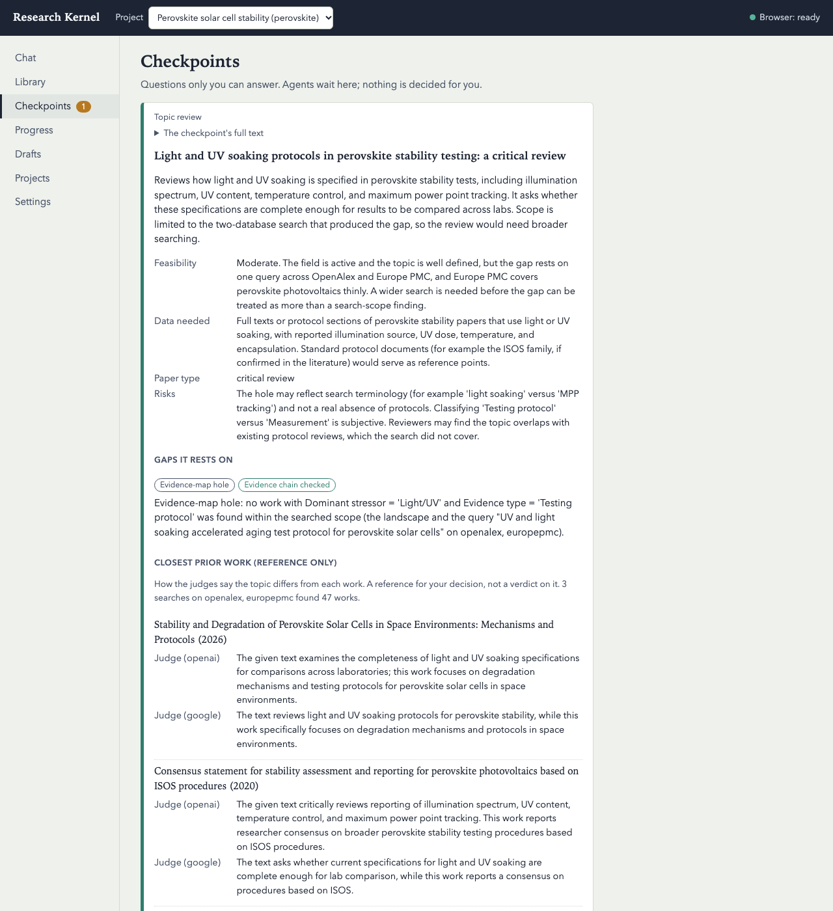

# Plan 4 demo: autonomous discovery (D2) from a field to a frozen research question (2026-11-07)

Recorded on macOS arm64 with a scratch `RK_HOME`, `rk serve` running headless in the background
(`RK_BROWSER_HEADLESS=1`), and the live APIs (OpenAlex, Europe PMC, PubMed, Crossref). Everything below comes from this
run's event log and CLI output. Item, gap and topic ids are the run's own.

**The human checkpoints were answered by the agent that ran the demo, standing in for the researcher.** Both answers
are recorded below with their reasons. In real use only you answer them.

## Setup

```
$ rk providers          # Anthropic-vendor roles on Claude Haiku 5.5; judges on other vendors
gapminer    claude_cli:claude-haiku-5-5            vendor=anthropic ok 2.1.309
ideator     claude_cli:claude-haiku-5-5            vendor=anthropic ok 2.1.309
judge       codex_cli                              vendor=openai    ok 0.167.0-alpha.3.2  (… != pinned 0.166.0-alpha.6 …)
judge_2     ollama:gemma4:12b-it-qat               vendor=google    ok
scout       claude_cli:claude-haiku-5-5            vendor=anthropic ok 2.1.309
triage      ollama:gemma4:12b-it-qat               vendor=google    ok
…           (lead, reader, screener_a, arguer, writer: claude_cli:claude-haiku-5-5)

$ rk project create perovskite --title "Perovskite solar cell stability" --field "perovskite solar cell stability" \
    --paper-type critical_review
$ rk project intake --audience "researchers in photovoltaics" --paper-type critical_review --mode d2 --production p2 \
    --topics-n 6
perovskite: critical_review for researchers in photovoltaics; discovery d2, production p2, language en, 6 topics
$ rk run perovskite --until question
started run_01M6T7S3KYM6J48EVZZDM8EQDK on perovskite (until question); follow it with: rk run status
```

`judge_2` and `triage` started on `ollama:deepseek-v4.1-flash:cloud` and were switched to a local Gemma model during the
run. The reason is under "What failed or was weak".

## Result

```
$ rk stage status
perovskite: current stage none (discovery passed)
stage      status   attempt
intake     passed   1
landscape  passed   1
gaps       passed   5
topics     passed   1
question   passed   2
  gaps->gaps: used 1 of 2
  question->question: used 1 of 2
```

The frozen research question, in the event log:

```
seq 2687  rq.frozen  rq_01M6TB81C63S99XBYG31WY0ZR0
          {"adopted_by": "human",
           "text_hash": "d7ce4784b36c745a67d9417faffe349ab7332bd0c8c586ebf6cba903d13735f0"}
          event hash 6a3c8e216af0a14e…
$ rk project status
  items=486 snapshots=24 notes=16 verifications=528 events=2691
  event chain: ok
```

## Landscape: 14 clusters, every cluster ≥ 5 verified works

The Scout ran 7 queries on OpenAlex and 7 on Europe PMC (14 logged searches). That gave 322 hits and 261 new items.
Every new item was checked: V-REF passed for 255 and found a mismatch for 6. V-RETRACT found no retracted work and 5
corrected ones. The Scout then grouped 164 of the hits into 14 clusters. "Verified" below means V-REF passed.

| Cluster | Works | Verified | Representatives |
|---|---|---|---|
| Operational stability reviews | 16 | 16 | 3 |
| Ion migration and field effects | 8 | 7 | 3 |
| Photoinduced halide segregation | 25 | 25 | 3 |
| Moisture, oxygen and encapsulation | 15 | 14 | 3 |
| Thermal, UV and light stress | 15 | 14 | 3 |
| Interfaces and charge transport layers (ETL/HTL) | 16 | 16 | 3 |
| Stability testing protocols and outdoor operation | 11 | 11 | 3 |
| Space and extreme-environment photovoltaics | 5 | 5 | 2 |
| Tin-based and mixed Sn-Pb perovskites | 7 | 6 | 3 |
| Defect passivation and additives | 11 | 10 | 3 |
| Self-assembled monolayer and hole-transport engineering | 11 | 11 | 3 |
| Two-dimensional and quasi-2D perovskites | 6 | 6 | 3 |
| Tandem, wide-bandgap and all-inorganic cells | 12 | 12 | 3 |
| Carbon, MXene and 2D-material electrodes | 6 | 5 | 3 |

## Gaps (attempt 5): 2 verified of 15 candidates

The open-access channels gave full text for 24 of the 41 representative works (17 Europe PMC JATS, 7 open-access PDFs).

| Kind | Candidates | Verified | Why the others are not verified |
|---|---|---|---|
| Evidence-map hole | 6 | 2 | 2: Triage put 1 searched work into the cell; 2: the GapMiner gave no query for the cell |
| Stated limitation | 5 | 0 | 3: Triage found 1 later work that addresses it; 1: the quote starts at 57 % of the text (needs ≥ 60 %); 1: the quote is not verbatim in the text layer |
| Contradiction | 2 | 0 | 1: V-SUPPORT verdict "unsupported", not "contradicted" (both judges agreed); 1: quote A is not verbatim in its source |
| Citation distortion | 2 | 0 | the GapMiner gave no item id or DOI for the cited work |
| Retracted but still cited | 0 | — | no retracted work in the clusters |

The two verified gaps:

- `gap_01M6TAAKR0F9NYA7DX0J7M6ZVE`: "Evidence-map hole: no work with Dominant stressor = 'Light/UV' and Evidence type =
  'Testing protocol' was found within the searched scope (the landscape and the query "UV and light soaking
  accelerated aging test protocol for perovskite solar cells" on openalex, europepmc)." The targeted search returned
  20 works, and Triage placed none of them in the cell.
- `gap_01M6TAAKR1RRWP2CN757VXJAE3`: the same for Heat × Testing protocol (query "thermal stress accelerated aging test
  protocol for perovskite solar cells damp heat thermal cycling"; 20 works, none in the cell).

"Verified" means the evidence chain was checked. It does not mean nothing exists: the two holes hold within one query
on two databases.

## Topics: 6 candidates, each with its closest works (V-NOVELTY, reference only)

Every topic rests on one or both verified gaps. For each topic, 1 Scout task and 2 judges (openai, google) produced 5
closest works, and the judges said how the topic differs from each. In the list, "ISOS consensus (2020)" stands for
"Consensus statement for stability assessment and reporting for perovskite photovoltaics based on ISOS procedures".

1. `tpc_01M6TAHQ89M1EDV7N27QW0N7A5` **Light and UV soaking protocols in perovskite stability testing: a critical
   review** (critical review). Closest works: Stability and Degradation of PSCs in Space Environments: Mechanisms and
   Protocols (2026); ISOS consensus (2020); Stability of perovskite solar cells: issues and prospects (2023);
   High-Throughput Aging System for Parallel MPP Tracking of PSCs (2022); a 2026 interfacial-dipole tandem paper.
2. `tpc_01M6TAMH30HZFC58WP8C219D93` Heat, damp-heat, and thermal-cycling protocols for perovskite solar cells (scoping
   review). Closest: the space-environments review (2026); Stability of PSCs: Degradation Mechanisms and Remedies
   (2021); PSCs for Extreme Environments (2026); a 23.6 % perovskite/silicon tandem (2017); PSCs: Progress and
   Advancements (2016).
3. `tpc_01M6TAPT52DYEAMHR9YHXCNM23` Do light and heat protocol differences explain conflicting perovskite lifetime
   reports? (systematic review). Closest: the space-environments review; two 2026 SAM papers; Interfaces in PSCs
   (2017); Stability of PSCs: issues and prospects (2023).
4. `tpc_01M6TAS67PYKW4ERS977ATMCZS` Interlaboratory comparison of light-soaking and UV exposure protocols (research
   proposal). Closest include An Interlaboratory Study on the Stability of All-Printable HTM-Free PSCs (2020) and
   Real-world operational characteristics of perovskite photovoltaics (2026).
5. `tpc_01M6TB2A3YJ78JG47ZBJ1R5QCF` A combined light-and-heat stress protocol for perovskite stability (research
   proposal). Its closest works are mostly off-topic: photodetectors, MXene optoelectronics, 2D perovskites and an
   FAPbI3 fabrication paper.
6. `tpc_01M6TB5S454CRRPW3ZK9Z7T6H5` Protocol transparency in perovskite stability reporting (critical review).
   Closest: ISOS consensus (2020); Degradation Mechanisms and Remedies (2021); a ZnO-nanorod review (2026); Interfaces
   in PSCs (2017); a CsBr UV-stability paper (2016).

### Topic review in the Workbench



The card shows the topic, its feasibility, data needed and risks. Below them are the gap it rests on, with the
"Evidence chain checked" badge, and the closest prior work with each judge's note ("a reference for your decision, not
a verdict on it"). The screenshot was taken with headless Chromium against the run's Workbench.

**Answer (stand-in researcher):** approve topic 1.

```
$ rk checkpoint answer chk_01M6TB5S49NWFDFD9R4W6JD540 --json '{"decision": "approve", "topic_id": "tpc_01M6TAHQ89M1EDV7N27QW0N7A5"}'
```

Why topic 1: it is the only critical review besides topic 6, which matches the intake. Topic 6's checklist aim overlaps
directly with the ISOS consensus statement, which already sets reporting requirements. Topic 1 is narrower: light and UV
soak specifications. Its own risks note says the hole may be a terminology artefact, and the RQ below turns that into a
falsifiable hypothesis.

## Research question

Attempt 1 failed the structural check: "finer.novel claims novelty; say what was not found within the searched scope".
The stage reran (question→question, 1 of 2), and the Ideator's second RQ passed. The already-done check then ran
5 queries on OpenAlex and Europe PMC and found 87 works. The judges (openai, google) rated the top 10, and both judged
every one "not answered", each with a verbatim quote. Result: `not_found_in_scope`, so in P2 an `rq_approval` opened.

> I am studying the light and UV soaking protocols specified in perovskite solar cell stability tests, including
> illumination spectrum, UV content, temperature control, maximum power point tracking and encapsulation because I want
> to find out whether these specifications are complete enough for stability results to be compared across
> laboratories in order to help my audience understand photovoltaics researchers can see which protocol details are
> missing and where they block cross-lab comparison of perovskite stability.

FINER "novel": "Not found within the searched scope: a single query across OpenAlex and Europe PMC returned no review
that treats light and UV soaking specifications as the object of study. This does not show that no such review
exists …". Three rival hypotheses, each with a falsification condition:

1. Most studies omit at least one key soak specification.
2. Completeness is higher in studies that cite ISOS.
3. The gap is a search-terminology artefact.

**Answer (stand-in researcher):** approve.

```
$ rk checkpoint answer chk_01M6TBD6SDGPH78BHJV54D3PRY --json '{"decision": "approve"}'
```

The question is scoped, honest about its search and falsifiable. The weakness: the 10 judged works do not include the
ISOS consensus statement, the closest prior work the topic stage found. The review must start from it.

## Task counts, waits and wall time

Role tasks of the runs, by stage:

| Stage | Tasks | Detail |
|---|---|---|
| landscape | 2 | scout 2 |
| gaps | 26 | attempt 4: gapminer 4 (1 failed), judge 2, judge_2 2 (failed), triage 5 (failed); attempt 5: gapminer 4, triage 7, judge 1, judge_2 1 |
| topics | 19 | ideator 1, scout 6, judge 6, judge_2 6 (1 + 6 × 3, as budgeted) |
| question | 5 | ideator 2, scout 1, judge 1, judge_2 1 |

By driver: Haiku 19 done and 1 failed; codex 10 done; local Gemma 15 done; Ollama Cloud 7 failed. No task came back
`rate_capped`, so there were no rate-cap waits.

Wall time:

- **Whole demo:** 64 min (05:30–06:34 UTC). This includes three crashed runs, two code fixes and a model download.
- **The run that finished** (`run_01M6T8P2JDHVC32GPJ1YC70TE2`): 48 min. This includes a 2 min pause for the model
  switch and 76 s of human waits.
- **Per stage:** landscape 6.5 min; gaps attempt 5 18.7 min; topics 12.6 min; question 3.3 min.

## What failed or was weak (calibration input)

**Runs that crashed, and the fixes** (each a separate commit; after each fix `rk serve` was restarted):

1. **Run 1 crashed in gaps:** `PydanticSerializationError: … surrogates not allowed`. pdfium returns UTF-16 code units,
   so a PDF with characters outside the BMP (e.g. math italic letters) produced lone surrogates, and saving its text
   layer failed. Fix `fix(text): lone surrogates in extracted PDF text no longer break the text layer`: surrogate pairs
   are joined and lone ones become U+FFFD. A failed run cannot be resumed (`rk run resume` → `no_run`), so a new run
   was started. It continued from gaps.
2. **Run 2 crashed in gaps:** `HttpError: HTTP 500` from Europe PMC full text. Only the arXiv and OA-URL channels caught
   HTTP errors. Fix `fix(fulltext): an HTTP error on one channel falls through to the next`.
3. **Run 3 crashed in gaps:** `JSONDecodeError`. For the same item, BioC answered 200 with a body that starts like JSON
   but is not JSON. Fix `fix(pubmed): a non-JSON BioC response means no document`.
4. **Run 4 finished**, after the switch below. One item's unexpected error still stops a whole stage; this is noted for
   the final review.

**The judge/triage models were switched mid-run.** In run 4 every `ollama:deepseek-v4.1-flash:cloud` call returned
HTTP 429 ("reached your monthly usage limit"). That was 5 triage and 2 judge_2 tasks. The limit is per account, so it
would also block the other `:cloud` models (not tried). The run was paused, `gemma4:12b-it-qat` was pulled into the
local Ollama (7 GB), and `judge_2` and `triage` were set to `ollama:gemma4:12b-it-qat` (vendor google). The run was
then resumed in session 2, so the generator (anthropic) still differs from both judges (openai, google).

- The local 12B model gave valid JSON on all 15 tasks: 0 retries.
- Its single V-SUPPORT opinion in the gaps stage had `spans_ok: false`: its evidence quote was not verbatim. This
  weakens judge_2 and triage against the planned cloud model.

**Gaps attempt 4 was lost.** It had no working triage or judge_2. Its distortion GapMiner task also failed with
`claude error_max_turns`. So the stage reran (gaps→gaps, 1 of 2).

**The evidence map in attempt 5 placed no works.**

- Haiku returned the map's `cells` keyed by cell ("Light/UV|Testing protocol" → item ids), not by item. `MapPlan.cells`
  is `dict[str, list[str]]` and accepts both shapes.
- The kernel ignored all 16 entries (`ignored_items`) and counted 0 works in every cell. It raised no problem, and every
  cell became "empty in the landscape".
- So the two verified holes rest on the targeted search and Triage alone. Attempt 4's map, in the expected shape, had
  placed 91 works. Its Light/UV and Heat × Testing protocol cells were also empty there (8 works in "Combined/outdoor
  × Testing protocol"), which supports the two holes but does not replace the check.
- This needs a fix: a map with every entry ignored should fail, or the schema should allow only one shape.

**Gap mining verified little.**

- 2 of 15 candidates were verified, and both are map holes in one corner of the map ("testing protocol").
- All 6 topics therefore circle the same two holes. Topic diversity is low.
- Distortion candidates came without a cited-work id or DOI. One limitation quote and one contradiction quote were not
  verbatim in the source.

**Closest-work retrieval (V-NOVELTY) and the already-done search are noisy.** Many of the closest works are off-topic:
a ZnO-nanorod review, photodetectors, MXene optoelectronics. The already-done top 10 included a wearable-sensor review
and a machine-learning review, but not the ISOS consensus statement.

**Other weak points:**

- **Full text:** 17 of 41 representative works had none. The browser channel recorded no visits (empty browse log),
  and the run made no publisher fetch.
- **Landscape trend data:** per-query year counts reach back to 1844 and 1956 (mis-dated or unrelated works matched by
  the query). Read the trends as rough.
- **codex CLI version:** 0.167.0-alpha.3.2 differs from the pinned 0.166.0-alpha.6 (`rk providers` warns). Its tasks
  succeeded.
